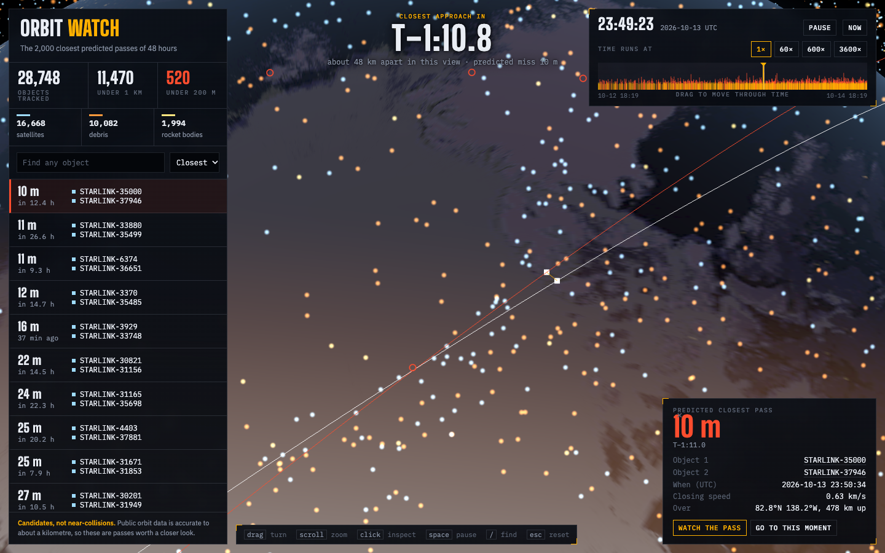

# Orbit Watch

Every tracked object in Earth orbit on a live 3D globe, with the closest predicted passes of the next 48 hours.


There are about 29,000 catalogued objects in orbit: working satellites, dead ones, spent rocket stages and fragments. Orbit Watch downloads the public orbit data for all of them, predicts where each will be, finds every pair that will pass within 5 km of each other, and shows the result on a globe you can spin and replay.

## Using the viewer

- **Drag** to turn the globe, **scroll** to zoom. Left alone, it turns slowly by itself.
- **Hover** any dot to see what it is and how high it flies. **Click** it for its speed, orbit and close passes, and press **Follow** to ride along with it.
- **Find any object** by name or catalogue number: the space station is `ISS (ZARYA)`.
- **Click a pass** in the list, or one of the red rings on the globe, to see the two orbits cross. **Watch the pass** jumps to a minute before and counts down alongside the pair.
- **Drag the timeline** to move through the 48 hours; each mark on it is a predicted pass, taller for closer ones. Time can run at up to 3,600 times real speed.
- The three counters under the title **switch satellites, debris and rocket bodies** on and off.
- Keys: `space` pauses, `/` jumps to the search box, `esc` resets, and the left and right arrows step ten minutes.

The lit side of the Earth is where the Sun really is at the time shown, and the city lights are on the night side.



## What has been measured

Run on an Apple M2 Pro laptop with public data fetched on 12 October 2026.

| Check                                                                 | Result                                                                                    |
| --------------------------------------------------------------------- | ----------------------------------------------------------------------------------------- |
| Orbit model against the official verification set (AIAA 2006-6753)    | all 666 positions of 31 objects agree to within 0.00012 m (worst case 0.000118 m)         |
| Screening against a brute-force search of every pair, every second    | 152 of 152 close approaches found, same time to 10 ms and distance to 1 m                 |
| Work avoided by the screening grid in that test                       | 99.86% of pair checks                                                                     |
| Full catalog, all pairs, 7 days                                       | 29,019 objects in 3 min 24 s                                                              |
| Full catalog, all pairs, 48 hours                                     | 28,748 objects in 57 s                                                                    |
| Agreement with CelesTrak SOCRATES where both used the same orbit data | 357 of 358 events found; time within 15 ms and miss distance within 0.5 m for 99% of them |

The 48-hour run found 205,612 passes under 5 km, 11,255 under 1 km and 511 under 200 m, plus 937 pairs that fly together on purpose (docked modules, formations), which are counted separately.

## Read this before quoting a number

**These are screening candidates, not near-collisions.** Public orbit data is accurate to roughly a kilometre, and less than that a few days ahead. A predicted miss of 10 m means "these two will be in the same small region at the same time", not "these two will pass 10 m apart". Operators decide on avoidance manoeuvres using their own, far more precise tracking. Nothing here should be used for that decision.

The comparison with SOCRATES covers 358 events only, because that is how many were computed from the same orbit data on both sides: my data was fetched about 22 hours after the report was produced, and most objects had been updated in between. One of the 358 was not found; for that pair my data puts the objects more than 50 km apart, which points to a reissued data set rather than a screening error, but I have not proven that. A matched snapshot is needed to repeat this at a larger scale.

## Run it

Requires Go 1.26. The viewer loads three.js and the Earth image from a CDN.

```sh
go build -o bin/orbitwatch ./cmd/orbitwatch
bin/orbitwatch fetch              # download the public orbit data (cached for 2 hours)
bin/orbitwatch screen -hours 48   # find close approaches, write web/data
bin/orbitwatch serve              # open http://127.0.0.1:8080
```

To repeat the checks:

```sh
go test ./...                     # orbit model, catalog, screening, fetching, pipeline
node --test web/orbit.test.mjs    # the viewer's orbit maths against the server's
go build -o bin/validate ./cmd/validate && bin/validate   # against a SOCRATES report in data/raw
```

## How it works

**Orbit model (`internal/sgp4`).** Public orbit data is published as "mean elements" that only make sense with one specific model, SGP4. The numerical core is adapted from [go-satellite](https://github.com/joshuaferrara/go-satellite), with three faults found and fixed while checking it against the official test set: a wrong constant in the branch for very low orbits (128 where the reference has 120), orbit reference times rounded down to whole seconds (worth up to 7 km of position), and a height calculation that failed above the poles.

**Screening (`internal/screen`).** 29,000 objects make 420 million pairs, so checking every pair at every instant is out of the question. Time is cut into 15-second steps. At each step every object is dropped into a grid of cubes sized so that two objects in cubes that do not touch cannot possibly meet before the next step. Only objects in the same or touching cubes are compared. For those, treating both as moving in straight lines for 15 seconds gives the time and distance of closest approach in closed form, and the few pairs that pass are refined with the real orbit model.

**Data (`internal/fetch`, `internal/catalog`).** Element sets are cached. A download replaces the cached copy only after it has been read completely and parsed, so an error page or a dropped connection never destroys good data. Sources are merged with the newest element set per object winning, except that anything dated in the future is rejected, and element sets older than 14 days are left out.

**Viewer (`web/`).** Plain JavaScript and three.js, no build step. The browser animates all objects with a lighter orbit model (an ellipse that drifts the way the Earth's bulge makes it drift). It is checked against SGP4 in the tests: the typical object is within 13 km over up to 40 hours, which is far less than a pixel. The list, distances and times come from the server's full-precision results.

## Keeping it current

```sh
bin/orbitwatch watch -serve 127.0.0.1:8080                      # refresh every 2 hours and serve the viewer
bin/orbitwatch watch -kafka-brokers localhost:9092               # also announce changes on Kafka
```

`watch` repeats the cycle (fetch, screen, rewrite the viewer's data) and, when brokers are given, publishes each new element set to `orbit.elements` and the closest passes to `orbit.conjunctions`. Two things were tested on purpose:

- **A failed cycle does not stop it.** An error or even a crash inside one cycle is reported and the next cycle runs.
- **Kafka is optional at every moment.** Publishing never blocks a cycle. With an unreachable broker, a full real cycle still completed and wrote its results; the messages were counted as failed.

Not yet tested: delivery to a real broker. The publisher is exercised against a stand-in in the tests only.

Downloads can never happen more often than CelesTrak's two-hour update interval, whatever flags are given, and a refusal (HTTP 403 or 429) is remembered on disk and backed off from for at least six hours. That rule exists because an early test of mine asked again after one hour and was, rightly, refused.

`Dockerfile` builds a small image that runs `watch` with the viewer, and `deploy/terraform` runs it on one AWS instance with the viewer port open only to networks you list. The Terraform passes `terraform validate`; it has not been applied.

## Deciding when to dodge (`rl/`)

Finding a close pass is half the problem. The other half is what an operator does about it, and that is a decision under uncertainty: a warning two days ahead is vague (predictions drift by about a kilometre per day), most warnings come to nothing, and fresh tracking keeps sharpening the picture. A burn made early moves the satellite a long way for almost no fuel but is often unnecessary. A burn made late is well informed but costs more for the same shift.

`rl/conjunction.py` simulates that for many warnings at once, with eight decision points from 48 hours to 3 hours before the pass. Its parts are checked independently: the effect of a burn against a numerical orbit integration (within 1% from 45 minutes to 30 hours ahead), the risk integral against exact and sampled answers, and the stated risk against outcomes (warnings rated about 10% fail about 10% of the time).

Three policies on the same million simulated warnings:

| Policy | Passes inside 200 m, per 1,000 warnings | Collisions per million | Fuel per warning | Burns on | Cost |
|---|---|---|---|---|---|
| Do nothing | 37.7 | 401 | 0 | 0% of warnings | 0.754 |
| Threshold rule, tuned by grid search | 0.17 | 0 | 0.26 cm/s | 16.4% | 0.0735 |
| Policy learned with PPO (3 runs) | 0.95 to 1.00 | 0 to 5 | 0.23 to 0.24 cm/s | 11.7% to 13.8% | 0.0819 ± 0.0012 |

**The learned policy does not beat the rule.** It learns, from reward alone, to cut the cost ninefold compared with doing nothing, and it burns less fuel than the rule, but it under-reacts in a small number of risky cases, and those are expensive. The tuned rule is about 11% cheaper overall. Training three times longer with a decaying step size narrowed the gap to about 7% (cost 0.0787 ± 0.0019 over 2 runs) without closing it.

Two cautions. The uncertainty model (0.1 km plus 1 km per day along the track, a tenth of that in the other directions) is an assumption chosen to match commonly quoted figures for public tracking data; it is not fitted to any operator's data, and every number in the table depends on it. And "cost" is my weighting of fuel against risk: one failure is priced at twenty full-size burns.

## Not done yet

- A comparison with SOCRATES on a matched snapshot, to repeat the 358-event check at scale.
- Delivery to a real Kafka broker, and a second data source alongside CelesTrak.
- Applying the Terraform, and a load test of the viewer.

## Data and credits

- Orbit data and the SOCRATES conjunction report: [CelesTrak](https://celestrak.org), Dr. T.S. Kelso. CelesTrak asks that each data set be requested no more than once per update; `orbitwatch fetch` waits two hours between requests.
- SGP4 reference code and verification set: Vallado, Crawford, Hujsak and Kelso, "Revisiting Spacetrack Report #3", AIAA 2006-6753.
- SGP4 Go port: Joshua Ferrara's go-satellite, BSD 2-Clause (licence in `internal/sgp4/LICENSE.go-satellite`).
- Rendering: [three.js](https://threejs.org), MIT. Earth image from the three.js examples.

## Licence

MIT. See `LICENSE`.
